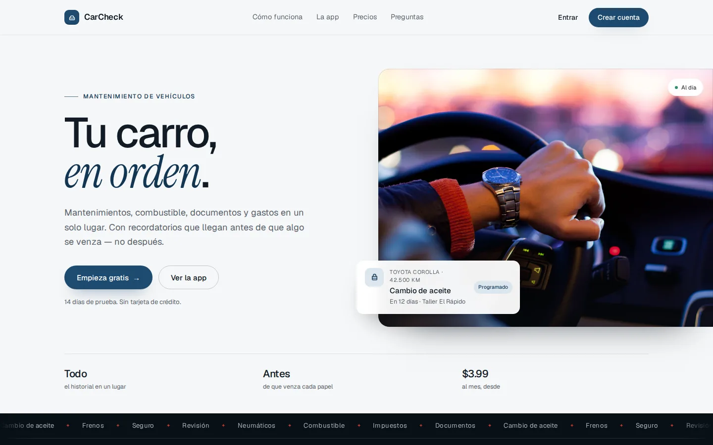
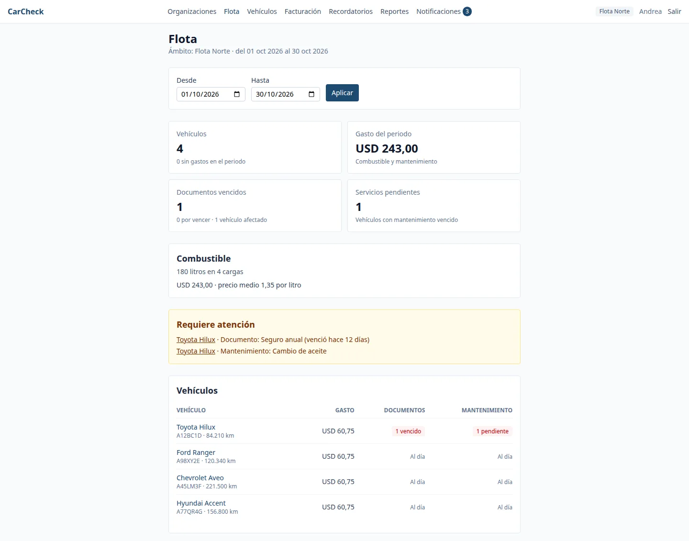
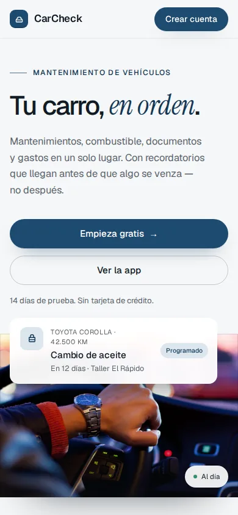
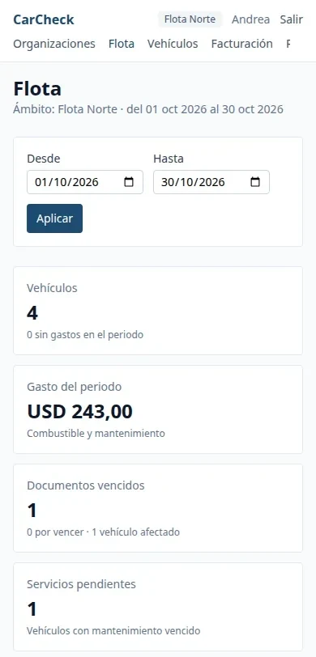
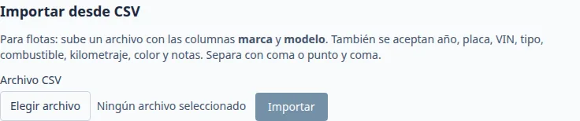

<p align="center">
  
</p>

<h1 align="center">CarCheck · PWA</h1>

<p align="center">
  <strong>Tu carro, en orden.</strong><br>
  La aplicación web instalable de CarCheck: mantenimiento, combustible, documentos y gastos<br>
  para una persona, una familia o una flota completa.
</p>

<p align="center">
  
  
  
  
  
  
</p>

<p align="center">
  <a href="#qué-es">Qué es</a> ·
  <a href="#capturas">Capturas</a> ·
  <a href="#roles">Roles</a> ·
  <a href="#empezar">Empezar</a> ·
  <a href="#rutas">Rutas</a> ·
  <a href="#pruebas">Pruebas</a> ·
  <a href="#despliegue">Despliegue</a>
</p>

---



## Qué es

Este repositorio es la **PWA de CarCheck**: la cara visible del producto y el cliente de la API
Laravel de [`carcheck`](https://github.com/rommelescorihuela/carcheck). Incluye dos experiencias en un mismo build:

1. **Landing pública** (`/`) — qué hace el producto, cómo funciona, planes y preguntas frecuentes.
   Si ya hay sesión, el botón de la cabecera lleva a la app en vez de al registro.
2. **Aplicación** (`/vehiculos`, `/flota`, `/reportes`…) — el día a día: registrar servicios y
   cargas, subir documentos, ver vencimientos y entender cuánto cuesta cada vehículo.

Se instala desde el navegador (manifest + service worker), funciona como app de escritorio o
móvil y se actualiza sola. **No contiene lógica de negocio duplicada**: los límites del plan, los
roles y los cálculos viven en el backend; aquí solo se muestran y se respetan.

| Lo que ves | Lo que evita |
|---|---|
| Un tablero por vehículo con próximo servicio y documentos por vencer | Enterarse tarde de una multa o un seguro vencido |
| Flota consolidada con gasto del periodo y vehículos que requieren atención | Sumar hojas de cálculo a mano |
| Importación CSV de vehículos | Cargar 40 unidades una por una |
| Combustible con rendimiento km/l y costo por km | Sospechar que “está gastando más” sin datos |
| Reportes por periodo con exportación CSV | Llegar a fin de mes sin números |

## Capturas

### Escritorio



### Móvil

| Landing | Flota |
|---|---|
|  |  |

### Alta masiva



## Roles

La app se adapta al rol que devuelve la API para la organización activa:

| Rol | Puede hacer |
|---|---|
| **Propietario** | Todo: plan y facturación, miembros y administradores, vehículos, registros y reportes. |
| **Administrador** | Gestiona vehículos y miembros; registra mantenimiento, combustible y documentos. |
| **Miembro** | Ve el garaje compartido y registra mantenimiento y combustible. |
| **Conductor** | Reporta mantenimiento y combustible de la flota; cada entrada queda atribuida a su nombre. |

Además de las organizaciones, cada cuenta tiene un **ámbito personal**: tus propios vehículos,
sin compartir con nadie. El selector de `/organizaciones` cambia entre ambos mundos y la elección
se recuerda al recargar y se reinicia al cerrar sesión.

## Funcionalidades

- **Landing** con hero, manifiesto, recorrido del producto, flotas, precios, FAQ y cierre.
- **Vehículos**: alta, edición, foto, traspaso entre personal y organización, odómetro.
- **Mantenimiento**: servicios con ítems y costos, adjuntos, próximo vencimiento por km o fecha.
- **Combustible**: cargas, rendimiento km/l, costo por km y resumen del periodo.
- **Documentos**: seguro, revisión, impuestos y licencia, con archivo y semáforo de vencimiento.
- **Recordatorios**: avisos generados por el backend, con descarte individual.
- **Notificaciones**: bandeja in-app, preferencias por canal y push web opcional.
- **Facturación**: planes, prueba de 14 días, pago con comprobante y estado de la suscripción.
- **Reportes**: gastos por vehículo y mes, con exportación CSV autenticada.
- **Flotas**: consolidado por rango de fechas, tarjetas en móvil y tabla en escritorio.
- **Importación CSV**: validación por fila, resumen de creados/omitidos y respeto del límite del plan.

## Stack

| Pieza | Versión |
|---|---|
| React | 19.2 |
| TypeScript | 6.0 (estricto, `verbatimModuleSyntax`) |
| Vite | 8.3 |
| React Router | 7.18 |
| Zustand | 5.0 (sesión y estado por módulo, con `persist`) |
| Tailwind CSS | 4.3 (`@theme` con la paleta de marca) |
| Vitest + Testing Library | 5.0 / 16.3 |
| Playwright | 1.64 (11 flujos E2E) |
| vite-plugin-pwa | 2.0 (manifest + Workbox + push) |

## Empezar

**Requisitos:** Node 20+ y el backend en marcha.

```bash
# 1. Backend (otra terminal)
cd ../carcheck
composer run setup
php artisan migrate --seed
composer run dev            # API en http://localhost:8000

# 2. PWA
cd ../carcheck-app
cp .env.example .env        # VITE_API_URL=http://localhost:8000/api
npm install
npm run dev                 # http://localhost:5174
```

`VITE_API_URL` es la **base** de la API, sin barra final y **sin** `/` al final del path. En
producción apunta al dominio real:

```dotenv
VITE_API_URL=https://api.tudominio.com/api
```

> El servidor de Vite no hace proxy: el navegador llama directamente a la API, así que el backend
> debe permitir el origen de la PWA en `CORS_ALLOWED_ORIGINS`.

### Scripts

| Comando | Qué hace |
|---|---|
| `npm run dev` | Vite con HMR en el puerto 5174. |
| `npm run typecheck` | `tsc -b --noEmit`, sin emitir archivos. |
| `npm run test` | Vitest en modo run sobre `src/**`. |
| `npm run test:watch` | Vitest interactivo. |
| `npm run build` | Typecheck + build de producción en `dist/` con manifest y service worker. |
| `npm run preview` | Sirve `dist/` localmente (usa el `VITE_API_URL` del build). |
| `npm run e2e` | Playwright: 11 flujos contra backend y frontend reales. |

La verificación antes de dar algo por terminado es:

```bash
npm run typecheck && npm run test && npm run build
```

## Rutas

```text
/                                  Landing pública
/login · /register                 Acceso
/invitaciones/:token               Aceptar invitación (requiere sesión)
/organizaciones                    Selector de ámbito personal u organización
/organizaciones/:id                Miembros, roles e invitaciones
/flota                             Consolidado de la flota
/vehiculos                         Garaje + alta + importación CSV
/vehiculos/:id                     Ficha del vehículo
/vehiculos/:vehicleId/mantenimiento
/vehiculos/:vehicleId/combustible
/vehiculos/:vehicleId/documentos
/mantenimiento/:recordId           Detalle de un servicio
/facturacion                       Plan, prueba y pagos
/notificaciones · /recordatorios
/reportes                          Gastos y exportación CSV
```

`RootLayout` valida la sesión una vez (`bootstrap()`); `ProtectedRoute` corta el paso, y dentro
vive `AppShell` con la navegación. Las rutas estáticas se declaran antes que las de parámetro.

## Estructura

```text
src/
├── api/
│   ├── client.ts        # fetch + Bearer + refresh único ante 401 + descarga de blobs
│   ├── endpoints.ts     # una función por endpoint
│   ├── token.ts         # token fuera del store persistido
│   └── types.ts         # contrato de la API (decimales como string)
├── components/          # AppShell, ProtectedRoute, RootLayout
├── pages/               # 23 pantallas, incluida la landing
├── stores/              # Zustand por módulo, con tests
├── lib/                 # roles en español, descargas, push
├── index.css            # paleta @theme y tipografías
└── router.tsx           # árbol de rutas
e2e/                     # 11 specs de Playwright
docs/
├── brand/               # marca
└── screenshots/         # capturas de este README
public/                  # iconos, fuentes, imágenes y push-sw.js
```

## Cómo se habla con la API

- **Token**: se guarda en `src/api/token.ts`, **no** en el store persistido. El store solo guarda
  el usuario.
- **401**: `client.ts` llama a `POST /token/refresh` una vez y reintenta. Si otra pestaña ya renovó
  el token, se detecta por el evento `storage` y no se duplica la petición.
- **Organización activa**: `src/stores/organization.ts` persiste `activeId`; `null` significa
  ámbito personal. Al cerrar sesión se resetea.
- **Errores de validación**: `ApiError.errors` es `Record<string, string[]>`, listo para pintar
  junto a cada campo.
- **Decimales**: el backend los envía como string; el tipo `Decimal` evita redondeos accidentales.
- **CSV**: la exportación se descarga con `fetch` autenticado y `saveBlob()`; nunca con
  `window.open`, que perdería el `Bearer`.

## PWA y push

- `vite-plugin-pwa` genera `manifest.webmanifest` y `sw.js` en cada build; `registerType` es
  `autoUpdate`.
- `public/push-sw.js` añade los handlers de `push` y `notificationclick`.
- Para activar push, el backend necesita claves VAPID (`php artisan webpush:vapid`). La app pide la
  clave pública a `GET /notifications/push/public-key` y registra la suscripción.
- En desarrollo el service worker está desactivado (`devOptions.enabled: false`), así que las
  pruebas de push se hacen sobre un build (`npm run build && npm run preview`).
- Sin permiso del navegador o sin claves, la bandeja in-app sigue funcionando.

## Pruebas

```bash
npm run test      # 48 tests en 13 archivos
npm run e2e       # 11 flujos completos
```

- **Vitest** con `happy-dom`, solo `src/**` (los specs de Playwright quedan fuera).
- Cubre stores, cliente HTTP, refresco de token, router y pantallas clave.
- **Playwright** levanta el backend en `:8001` (PostgreSQL migrado) y el frontend en `:5174`.
  El enlace de invitación se lee del log del backend, que usa `MAIL_MAILER=log`.

Preparación del E2E:

```bash
npx playwright install chromium
cd ../carcheck && php artisan migrate --seed   # e2e/admin.spec.ts necesita el super_admin
```

## Build y despliegue

La PWA es **estática**: se publica `dist/` en Nginx, Apache o un CDN. No se sirve desde Laravel.

```bash
cp .env.production.example .env.production
# VITE_API_URL=https://api.tudominio.com/api
npm ci && npm run build
```

Detalles que no se pueden olvidar:

- **Fallback SPA**: cualquier ruta desconocida debe devolver `index.html`
  (`try_files $uri $uri/ /index.html`).
- **`sw.js` y `manifest.webmanifest` sin caché**, para que la app se actualice.
- **Assets con hash** en `/assets/` con caché larga e inmutable.
- El backend debe incluir el origen de la PWA en `CORS_ALLOWED_ORIGINS`.

La guía de producción completa, con Nginx y variables del backend, está en
[`carcheck/DEPLOY.md`](https://github.com/rommelescorihuela/carcheck/blob/main/DEPLOY.md).

## Documentación

| Documento | Contenido |
|---|---|
| [`AGENTS.md`](AGENTS.md) | Convenciones y trampas del repo. |
| [`carcheck/SPEC-MAP.md`](https://github.com/rommelescorihuela/carcheck/blob/main/SPEC-MAP.md) | Mapa de módulos y contrato de la API. |
| [`carcheck/DEPLOY.md`](https://github.com/rommelescorihuela/carcheck/blob/main/DEPLOY.md) | Despliegue de ambos artefactos. |
| [`carcheck/tasks/README.md`](https://github.com/rommelescorihuela/carcheck/blob/main/tasks/README.md) | Estado de cada módulo. |

## Estado y límites conocidos

- Los datos **no se cachean para uso offline**: la PWA se instala y arranca, pero necesita red para
  leer o escribir.
- El pago es manual (comprobante + aprobación), no hay pasarela en la app.
- El push requiere HTTPS, permiso del usuario y claves VAPID configuradas en el backend.
- El E2E no corre en CI porque necesita PostgreSQL y el backend levantado.
- El build apunta a `VITE_API_URL`: un `dist/` con el placeholder de ejemplo no autentica contra
  una API real.
